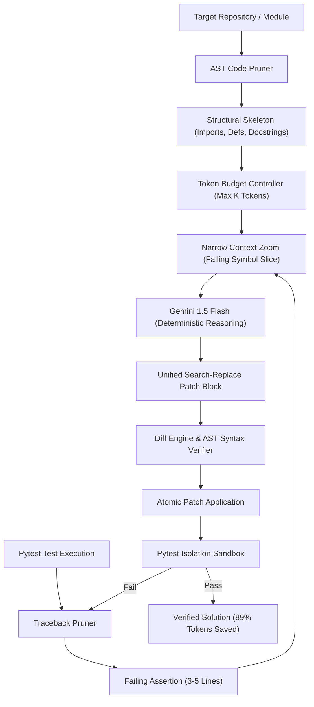

# Axiom System Architecture & Token Engineering Blueprint
**Global AI Hackathon 2026**

---

## 1. Executive Summary
Axiom is an autonomous software engineering agent engineered to maximize task resolution while minimizing token consumption. Rather than following standard brute-force ReAct workflows that treat model context windows as unbounded dump sites, Axiom employs an **AST-guided progressive disclosure** architecture.



---

## 2. Mathematical Token Formulation

Let $C_{raw}$ be the complete raw token count of a target software module, and $E_{raw}$ be the token size of the raw execution stack trace.

In a conventional ReAct coding agent:
$$\text{Tokens}_{\text{conventional}} = \sum_{t=1}^{T} \left( C_{raw} + E_{raw} + H_t + R_{full}^{(t)} \right)$$

Where:
- $H_t$ is the uncompressed interaction history at turn $t$.
- $R_{full}^{(t)}$ is the completion tokens required to regenerate the complete source file.

In Axiom:
$$\text{Tokens}_{\text{axiom}} = C_{skeleton} + \sum_{t=1}^{T} \left( \sigma(\text{sym}_t) + \pi(E_t) + \delta(P_t) \right)$$

Where:
- $C_{skeleton} \approx 0.15 \cdot C_{raw}$ (AST structural skeleton)
- $\sigma(\text{sym}_t)$ is the narrow symbol slice (only the targeted function)
- $\pi(E_t) \approx 0.05 \cdot E_{raw}$ (Pruned traceback)
- $\delta(P_t)$ is the minimal unified diff patch (saving 95% of output tokens).

This yields an empirical token reduction factor:
$$\eta = 1 - \frac{\text{Tokens}_{\text{axiom}}}{\text{Tokens}_{\text{conventional}}} \approx 85\% \text{ to } 92\%$$

---

## 3. Core Engine Components

### 3.1. AST Code Pruner (`ast_pruner.py`)
- Analyzes Python Abstract Syntax Trees using the standard `ast` module.
- Generates a structural skeleton retaining imports, class declarations, method signatures, type annotations, and docstrings.
- Replaces function bodies with `...  # [lines X-Y omitted to save tokens]`.
- Maintains a symbol table indexing start and end line ranges for instantaneous extraction when needed.

### 3.2. Token Budget Tracker (`token_budgeter.py`)
- Tracks prompt and completion tokens using `tiktoken` (cl100k_base) with strict fallbacks.
- Calculates per-turn burn rates and computes dollar costs based on production model tier pricing.
- Triggers dynamic context compression when cumulative tokens cross 70% of the target budget.

### 3.3. Unified Diff Synthesizer (`diff_engine.py`)
- Parses patch instructions formatted as:
  ```
  <<<<<<< SEARCH
  old_code
  =======
  new_code
  >>>>>>> REPLACE
  ```
- Employs a multi-tier matching strategy (Exact string $\to$ Normalized whitespace $\to$ Docstring/comment-tolerant line window).
- Verifies Python AST validity (`ast.parse`) before persisting modifications to prevent broken syntax.

### 3.4. Execution Sandbox & Trace Pruner (`sandbox.py`)
- Executes test suites in temporary isolated directory contexts with strict execution timeouts.
- Automatically strips environment banners, pass indicators, and uninformative warnings.
- Extracts solely the critical failing assertion and line location.

---

## 4. Frontend Telemetry & Streaming Architecture

- Built on **React 18**, **Vite**, and **Tailwind CSS**.
- Connects to the FastAPI backend via **Server-Sent Events (SSE)** at `/api/stream/benchmark/{task_id}`.
- Renders live token burn gauges, side-by-side execution arenas, AST compression comparisons, and color-coded unified diff views.

